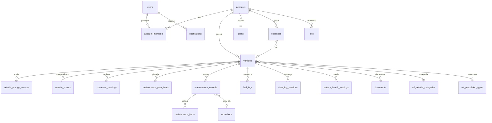

# Modelo de dados

Fonte da verdade: `db/migrations/0001_init.sql` (validada em PostgreSQL 16 por `db/run-tests.sh`).

## Diagrama (núcleo do MVP)

## Decisões de modelagem

| Decisão | Motivo |
|---------|--------|
| **`account_id` em todas as tabelas de negócio** (desnormalizado) | RLS simples e rápida (sem *joins* na política) e sincronização filtrada por índice `(account_id, server_seq)` |
| Conta pessoal e organização no **mesmo modelo** | A frota (Fase 5) não exige reescrita: é uma conta com vários membros e papéis |
| Categorias, propulsões, energias e categorias de despesa como **tabelas de referência** | Nova categoria = `INSERT`. Testado com "máquina agrícola" sem migração estrutural |
| `vehicles.attributes jsonb` | Campos específicos de categoria (configuração de eixos, implemento) sem multiplicar colunas. Os campos são validados no domínio |
| `vehicle_energy_sources` N:N | Flex (gasolina + etanol), kit GNV, PHEV (combustível + eletricidade) |
| Dinheiro em **centavos `bigint`**; preço de combustível em **milésimos `integer`** | Sem erro de ponto flutuante; R$ 5,879/L é representável |
| `expenses.origin_type/origin_id` com índice único | Abastecimento ou manutenção geram uma única despesa (sem duplicidade) |
| `interval_source` obrigatório no plano de manutenção | Distingue manual do fabricante, usuário e modelo genérico (requisito do produto) |
| `source`/`confidence` em medições | Procedência explícita; não simular dados de bateria ou telemetria |
| Exclusão lógica (`deleted_at`) | Necessária para sincronizar exclusões e permitir recuperação; a exclusão física segue a política de retenção |
| `audit_log` só de inserção, com diff por campo | Auditoria e suporte à mescla de conflitos da sincronização |

## Entidades planejadas para migrações futuras (Fase 5)

| Migração | Entidades |
|----------|-----------|
| 0002 frota | `drivers` (vínculo opcional com `users`, CNH), `vehicle_assignments`, convites |
| 0003 pneus | `tires`, `tire_positions` (layout por configuração de eixos), `tire_events` (montagem, rodízio, recapagem, medição de sulco e pressão) |
| 0004 viagens | `trips`, `trip_legs`, `trip_expenses`, `checklists`, `checklist_runs`, `cargo` (tonelagem para custo por tonelada) |
| 0005 IA | `ai_messages`, `ai_usage` (tokens/custo por usuário), `extracted_documents` (OCR com revisão) |
| 0006 serviços | `service_providers`, `reviews`, `quotes` |
| 0007 emergências | `emergency_contacts`, `incidents`, `location_shares` (com expiração e consentimento explícito) |

A tabela `ai_conversations` já existe vazia para fixar a convenção de nomes. Ela só será usada na Fase 5.
