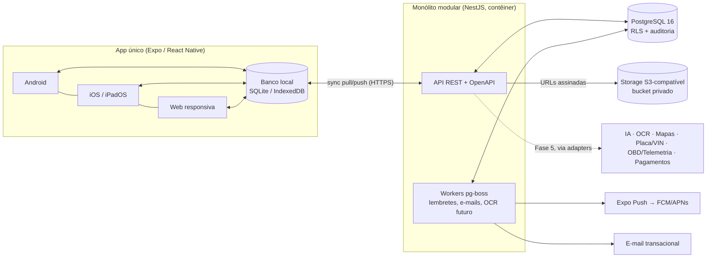
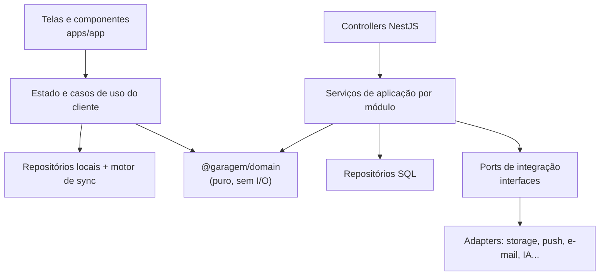

# Arquitetura — Visão geral

Decisões fundamentadas em `docs/adr/0001-0008-decisoes-iniciais.md`.

## 1. Diagrama de contexto



## 2. Camadas e dependências



Regras:
1. `@garagem/domain` não importa nada de infraestrutura. Ele roda igual no celular offline e no servidor.
2. As telas nunca decidem regra de negócio. Por exemplo, quais campos mostrar vem de `getCapabilities()`.
3. Integrações externas entram só por *ports* (interfaces). Cada adapter tem timeout, *retry* com *backoff*, *circuit breaker*, registro de custo e um **adapter "indisponível"** que informa a limitação ao usuário, em vez de simular resposta.

## 3. Estrutura do repositório

```
plataforma-veicular/
├── docs/
│   ├── produto/          visão, requisitos, MVP/roadmap, riscos
│   ├── arquitetura/      este documento, dados, sync, segurança
│   └── adr/              registros de decisão
├── packages/
│   ├── domain/           ✅ regras de negócio compartilhadas (TS) + testes
│   ├── api-contract/     ⏭ OpenAPI + cliente TS gerado
│   └── ui/               ⏭ design system (tokens, componentes acessíveis)
├── apps/
│   ├── api/              ⏭ NestJS (módulos: auth, vehicles, maintenance, documents,
│   │                        finance, fuel, sync, notifications, files)
│   └── app/              ⏭ Expo Router (Android, iOS, web)
├── db/
│   ├── migrations/       ✅ SQL versionado (0001_init.sql)
│   ├── tests/            ✅ testes de RLS, sync, auditoria, restrições
│   └── run-tests.sh
└── infra/                ⏭ Dockerfile, docker-compose (dev), CI
```

## 4. Estrutura da API (MVP)

Prefixo `/v1`. Autenticação Bearer (JWT de 15 min). Lista de erros no formato `application/problem+json` (RFC 9457).

| Recurso | Endpoints principais |
|---------|----------------------|
| Auth | `POST /auth/register`, `/auth/login`, `/auth/refresh`, `/auth/logout`, `/auth/password/forgot`, `/auth/password/reset`, `/auth/email/verify`, `GET /auth/sessions`, `DELETE /auth/sessions/:id` |
| Conta / LGPD | `GET /me`, `POST /me/export` (job assíncrono, link por e-mail), `DELETE /me`, `POST /me/consents` |
| Veículos | `GET/POST /vehicles`, `GET/PATCH/DELETE /vehicles/:id`, `GET /vehicles/:id/capabilities`, `POST /vehicles/:id/shares` |
| Manutenção | `GET/POST /vehicles/:id/maintenance`, `GET/POST /vehicles/:id/maintenance-plan`, `GET /vehicles/:id/maintenance-plan/due` |
| Documentos | `GET/POST /documents`, `PATCH/DELETE /documents/:id` |
| Abastecimento / recarga | `GET/POST /vehicles/:id/fuel-logs`, `GET/POST /vehicles/:id/charging-sessions`, `GET /vehicles/:id/consumption` |
| Financeiro | `GET/POST /expenses`, `GET /reports/costs?vehicleId&from&to`, `GET /reports/costs.csv` |
| Arquivos | `POST /files` (retorna URL de upload assinada), `GET /files/:id/url` (URL de leitura com 5 min de validade) |
| Sincronização | `POST /sync/pull`, `POST /sync/push` (ver `sincronizacao.md`) |
| Notificações | `GET /notifications`, `POST /notifications/:id/read`, `POST /devices` |

As escritas da interface **online** e do **push offline** passam pelos mesmos serviços de aplicação. Não existe caminho de escrita que pule validação.

## 5. Ambientes

| Ambiente | Finalidade | Dados |
|----------|-----------|-------|
| `local` | Desenvolvimento (docker-compose: Postgres + MinIO + API) | Fictícios, gerados por *seed* identificado |
| `ci` | Testes automatizados em banco efêmero | Fictícios, descartados |
| `staging` | Homologação, beta interno | Fictícios ou de testadores que consentiram |
| `production` | Usuários reais | Reais; nenhum *seed* fictício é aplicado (verificação no pipeline) |

Segredos ficam apenas no gerenciador de segredos do provedor, nunca no repositório (`.env` está no `.gitignore`; existe só um `.env.example`).
