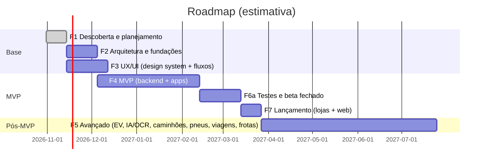

# 03 — Escopo do MVP e Roadmap

## 1. O que entra no MVP (e por quê)

O MVP precisa atender aos **critérios de aceitação da seção 16 do prompt-mestre** e validar a proposta de valor com P1/P2 (pessoa física, incluindo elétricos). Tudo o que não for necessário para isso fica para depois.

| Entra no MVP | Fica para depois | Motivo do corte |
|--------------|------------------|-----------------|
| Conta, login, recuperação de senha, LGPD (exportar/excluir) | Login social (S, entra se houver tempo) | — |
| Garagem com cadastro manual adaptado à propulsão | Consulta por placa/VIN | Exige fornecedor autorizado e contrato (R-01) |
| Manutenção + planos com intervalos e origem declarada | Planos oficiais por modelo | Licenciamento de dados (R-03) |
| Documentos + upload + alertas | OCR, consulta oficial de débitos | OCR é Fase 5; consultas oficiais não têm API aberta (R-04) |
| Despesas, relatórios mensal/anual, R$/km, CSV | PDF, orçamento, recorrência | Valor incremental menor |
| Abastecimento + consumo + **recarga elétrica básica** | SOH, telemetria, OBD | Exige integrações que não temos (R-05) |
| Notificações push/e-mail + central | SMS/WhatsApp | Custo e opt-in |
| Dashboard por veículo, linha do tempo | Busca global e calendário (S) | — |
| Sincronização offline no app móvel | — | Critério de aceitação |
| App Android, iOS e web | — | Critério de aceitação |
| **Modelo de dados multiempresa** (sem a interface de frota) | Interface de frota, motoristas, perfis | Evita reescrever o banco na Fase 5 |

## 2. Roadmap realista

> Estimativas para um time enxuto (2–3 devs full-stack + 1 designer em meio período). São **ordens de grandeza para planejamento**, não compromissos. Serão recalibradas ao fim de cada fase.

| Fase | Duração estimada | Entregáveis-chave | Critério de saída |
|------|------------------|-------------------|-------------------|
| **F1 Descoberta** | 2 semanas | Visão, requisitos, MVP, riscos, roadmap (**este pacote**) + validação com 10–15 entrevistas | Escopo do MVP aprovado pelo responsável pelo produto |
| **F2 Arquitetura** | 3 semanas | ADRs, modelo de dados (migração SQL testada), contrato de API (OpenAPI), protocolo de sincronização, monorepo com CI | Esqueleto rodando de ponta a ponta: app ↔ API ↔ banco, com CI verde |
| **F3 UX/UI** (em paralelo à F2) | 4 semanas | Design system, wireframes, protótipo navegável, testes de usabilidade com 5 usuários | Fluxos críticos validados |
| **F4 MVP** | ~10 semanas | Módulos 0–5 + notificações + dashboard + sincronização | Critérios da seção 16 atendidos em staging |
| **F6a Testes/beta** | 4 semanas | Beta fechado (TestFlight / teste interno do Play), correções, teste de carga, revisão de segurança | Sem erros críticos; crash-free ≥ 99,5% |
| **F7 Lançamento** | 2 semanas | Publicação nas lojas, política de privacidade e termos revisados por advogado, monitoramento | Apps aprovados nas lojas |
| **F5 Avançado** | contínuo, por trimestres | Ordem sugerida: EV avançado → IA/OCR → caminhões + pneus → viagens → frotas → serviços | Uma funcionalidade por vez, com métrica de uso |

## 3. Primeiros entregáveis (próximas iterações)

| # | Entregável | Status |
|---|------------|--------|
| E-01 | Documentos de produto da Fase 1 (este diretório) | ✅ Entregue |
| E-02 | ADRs da arquitetura e diagramas | ✅ Entregue (`docs/adr`, `docs/arquitetura`) |
| E-03 | Pacote de domínio `@garagem/domain` (taxonomia, matriz de capacidades, consumo, manutenção, documentos, validação de placa/VIN), com testes | ✅ Entregue — ver resultado dos testes no README |
| E-04 | Migração SQL inicial (multiempresa, RLS, auditoria, sincronização), validada em PostgreSQL 16 | ✅ Entregue — ver README |
| E-05 | API NestJS: autenticação + veículos + endpoints de sincronização, com testes de integração | ⏭ Próxima iteração |
| E-06 | App Expo (iOS/Android/web): login, garagem, cadastro adaptativo | ⏭ Próxima iteração |
| E-07 | CI (GitHub Actions): lint, testes, migração em banco efêmero | ⏭ Próxima iteração |

## 4. Tarefas de descoberta que dependem do time ou do negócio

| ID | Tarefa | Responsável |
|----|--------|-------------|
| D-01 | Definir nome definitivo e fazer busca no INPI | Produto/Jurídico |
| D-02 | Definir preços e regras dos planos (nenhuma cobrança real até isso existir) | Produto/Negócio |
| D-03 | Escolher e contratar fornecedor de consulta por placa/VIN (se houver) | Negócio + Jurídico (LGPD) |
| D-04 | Validar a análise de concorrentes com testes atualizados dos apps | Produto |
| D-05 | 10–15 entrevistas com P1/P2/P3 para validar prioridades | Produto/UX |
| D-06 | Definir provedor de hospedagem e região (ver ADR-0006) | Engenharia + Jurídico |
